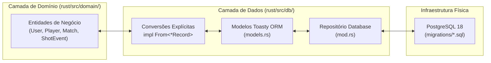
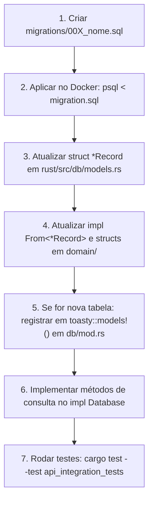

# Guia Técnico: Migrações SQL e Toasty ORM (PostgreSQL 18)

Este documento é a referência central sobre como o **banco de dados relacional** e a **camada de persistência** do **Player Scout** funcionam. Ele foi elaborado especialmente para orientar desenvolvedores (inclusive juniores e novos membros da equipe) a evoluir esquemas, criar migrações e manipular o Toasty ORM com segurança e sem introduzir quebras.

---

## 1. Visão Geral da Arquitetura de Persistência

O Player Scout adota uma separação rigorosa entre o **Domínio** (regras de negócio puras), os **Modelos de Persistência** (Toasty ORM) e o **Banco Físico** (PostgreSQL 18):



### Por que essa separação é importante?
- **Isolamento de Domínio:** Se o banco de dados mudar ou uma coluna for renomeada, o código de regras de negócio em `domain/` não é afetado diretamente.
- **Tipagem Forte:** O compilador Rust garante que conversões entre o banco e o domínio sejam válidas antes mesmo da aplicação iniciar.

---

## 2. Inventário das Migrações Existentes

Todas as migrações SQL ficam localizadas na raiz do repositório em `/migrations`:

| Arquivo | Propósito / O que faz | Tabelas / Enums Criados |
| :--- | :--- | :--- |
| [`001_initial_schema.sql`](file:///home/jc/codigos/rust/player-scout/migrations/001_initial_schema.sql) | Esquema fundamental do scout de padel | Tabelas: `users`, `players`, `coach_players`, `matches`, `shot_events`. Enums: `shot_type_enum` (21 jogadas), `shot_outcome_enum`, `decision_quality_enum`, `special_tag_enum`, `preferred_side_enum`, `match_status_enum`. |
| [`002_user_roles.sql`](file:///home/jc/codigos/rust/player-scout/migrations/002_user_roles.sql) | Separação de papéis de usuários | Enum: `user_role_enum` (`admin`, `coach`). Coluna `role` adicionada a `users`. |
| [`003_player_role_and_multi_coach.sql`](file:///home/jc/codigos/rust/player-scout/migrations/003_player_role_and_multi_coach.sql) | Papel de atleta e múltiplos treinadores | Adiciona valor `player` ao `user_role_enum`, associa `user_id` em `players` e amplia `coach_players`. |
| [`004_auth_registration_and_oauth.sql`](file:///home/jc/codigos/rust/player-scout/migrations/004_auth_registration_and_oauth.sql) | Cadastro completo e Login Social | Campos em `users`: `first_name`, `last_name`, `age`, `cpf` (UNIQUE), `whatsapp_phone`, endereço completo. Cria tabela `user_oauth_accounts` e enum `oauth_provider_enum` (`google`, `microsoft`, `instagram`). |
| [`005_user_sessions_and_brute_force.sql`](file:///home/jc/codigos/rust/player-scout/migrations/005_user_sessions_and_brute_force.sql) | Sessão única 12h e defesa de força bruta | Cria tabela `user_sessions` (com `UNIQUE (user_id)`). Adiciona `failed_login_attempts` e `locked_until_epoch` em `users`. |
| [`006_user_soft_delete_deactivation.sql`](file:///home/jc/codigos/rust/player-scout/migrations/006_user_soft_delete_deactivation.sql) | Desativação lógica de contas (Soft Delete) | Coluna `is_active BOOLEAN NOT NULL DEFAULT TRUE` e índice condicional em `users`. |
| [`007_match_players.sql`](file:///home/jc/codigos/rust/player-scout/migrations/007_match_players.sql) | Suporte a 4 atletas ativos em quadra | Cria tabela associativa `match_players` (`match_id`, `player_id`, `team`, `court_side`, `is_scouted`). |

---

## 3. Como Executar e Aplicar Migrações

### 3.1. Ambiente Novo / Inicialização via Docker Compose
No arquivo [`docker-compose.yml`](file:///home/jc/codigos/rust/player-scout/docker-compose.yml), a pasta `./migrations` é montada diretamente no diretório de inicialização do PostgreSQL:

```yaml
volumes:
  - ./migrations:/docker-entrypoint-initdb.d:ro
```

Quando o container `player_scout_postgres` sobe pela primeira vez, o PostgreSQL executa automaticamente todos os scripts `*.sql` em ordem alfabética (`001`, `002`, `003`...).

### 3.2. Ambiente Existente / Aplicação Incremental
Se o container Docker já estiver rodando e você criar uma nova migração (por exemplo `migrations/008_minha_melhoria.sql`), aplique-a executando:

```bash
docker exec -i player_scout_postgres psql -U postgres -d playerscout_dev < migrations/008_minha_melhoria.sql
```

---

## 4. O Toasty ORM no Player Scout

O **Toasty** é um ORM moderno, assíncrono e nativo para o ecossistema Tokio/Rust. No Player Scout, ele é configurado em [`rust/src/db/models.rs`](file:///home/jc/codigos/rust/player-scout/rust/src/db/models.rs) e consumido em [`rust/src/db/mod.rs`](file:///home/jc/codigos/rust/player-scout/rust/src/db/mod.rs).

### 4.1. Anotações Principais de Modelo

```rust
#[derive(Debug, Clone, toasty::Model)]
#[table = "users"]                  // Nome exato da tabela no PostgreSQL
pub struct UserRecord {
    #[key]                          // Chave primária
    #[auto]                         // Gerada automaticamente se omitida
    pub id: Uuid,

    #[unique]                       // Restrição de unicidade (UNIQUE)
    pub email: String,

    #[index]                        // Gera índice para consultas rápidas
    pub coach_id: Option<Uuid>,

    pub role: UserRole,             // Enums mapeados (veja abaixo)
    pub is_active: bool,
}
```

### 4.2. Tabelas Associativas com Chave Composta (N:N)
Para tabelas relacionais como `coach_players` e `match_players`, utilizamos chaves particionadas:

```rust
#[derive(Debug, Clone, toasty::Model)]
#[table = "match_players"]
#[key(partition = match_id, local = player_id)]
pub struct MatchPlayerRecord {
    pub match_id: Uuid,
    pub player_id: Uuid,
    pub team: String,
    pub court_side: PreferredSide,
    pub is_scouted: bool,
}
```

### 4.3. Mapeamento de Enums do PostgreSQL
Quando um enum é definido no PostgreSQL via `CREATE TYPE meu_enum AS ENUM (...)`, o Toasty exige que o enum correspondente em Rust receba `#[derive(toasty::Embed)]` e a coluna da tabela receba o atributo `#[column(type = enum("..."))]`:

```rust
// No domínio (rust/src/domain/auth.rs):
#[derive(Debug, Clone, Copy, PartialEq, Eq, Serialize, Deserialize, toasty::Embed)]
#[serde(rename_all = "snake_case")]
#[column(type = enum("oauth_provider_enum"))]
pub enum OAuthProvider {
    Google,
    Microsoft,
    Instagram,
}
```

### 4.4. A Estratégia de Identificadores UUID v7
O Player Scout adota **UUID v7** gerados via `Uuid::now_v7()`.
- **Benefício de Performance:** Os IDs são cronologicamente ordenáveis no índice B-Tree do PostgreSQL, evitando fragmentação de disco.
- **Timestamp Embutido:** A função [`timestamp_from_uuid`](file:///home/jc/codigos/rust/player-scout/rust/src/db/models.rs#L11-L19) extrai o instante de criação diretamente dos 48 bits iniciais do próprio UUID, dispensando colunas redundantes em tabelas leves:
  ```rust
  let created_at: DateTime<Utc> = timestamp_from_uuid(&rec.id);
  ```

---

## 5. Padrões de Operações CRUD no Toasty ORM

Todos os métodos de banco são implementados dentro da struct [`Database`](file:///home/jc/codigos/rust/player-scout/rust/src/db/mod.rs#L26).

### 5.1. Inserção (Create)
Utilize a macro `toasty::create!`:
```rust
let created_record = toasty::create!(UserRecord {
    id: Uuid::now_v7(),
    name: name,
    email: email,
    role: role,
    // ... demais campos obrigatórios
})
.exec(&mut db)
.await?;
```

### 5.2. Busca por Chave Primária (Get by ID)
```rust
let user_rec = UserRecord::get_by_id(&mut db, &user_id).await?;
```

### 5.3. Listagem e Filtros (Query)
```rust
let all_records = MatchRecord::all().exec(&mut db).await?;
let player_matches: Vec<MatchRecord> = all_records
    .into_iter()
    .filter(|m| m.player_id == player_id)
    .collect();
```

### 5.4. Atualização de Registro (Update)
```rust
let mut user_rec = UserRecord::get_by_id(&mut db, &user_id).await?;
user_rec
    .update()
    .name(new_name)
    .preferred_side(new_side)
    .exec(&mut db)
    .await?;
```

### 5.5. Exclusão (Delete)
```rust
let session_rec = UserSessionRecord::get_by_id(&mut db, &session_id).await?;
session_rec.delete().exec(&mut db).await?;
```

---

## 6. Receita Prática: Como Adicionar uma Nova Coluna / Tabela

Siga este checklist rigorosamente quando precisar evoluir o banco de dados:



### Exemplo: Adicionando a coluna `ranking_points INT` na tabela `players`

1. **Criar a migração `migrations/008_add_player_ranking_points.sql`:**
   ```sql
   ALTER TABLE players ADD COLUMN ranking_points INT NOT NULL DEFAULT 0;
   ```
2. **Aplicar localmente:**
   ```bash
   docker exec -i player_scout_postgres psql -U postgres -d playerscout_dev < migrations/008_add_player_ranking_points.sql
   ```
3. **Atualizar `PlayerRecord` em `rust/src/db/models.rs`:**
   ```rust
   pub struct PlayerRecord {
       // ... campos existentes
       pub ranking_points: i32,
   }
   ```
4. **Atualizar `Player` em `rust/src/domain/player.rs` e o `From<PlayerRecord>` em `models.rs`:**
   ```rust
   impl From<PlayerRecord> for Player {
       fn from(rec: PlayerRecord) -> Self {
           Self {
               // ...
               ranking_points: rec.ranking_points,
           }
       }
   }
   ```
5. **Executar a suíte de testes:**
   ```bash
   cargo test --test domain_validation_tests
   cargo test --test api_integration_tests
   ```

---

## 7. Pegadinhas Comuns & Troubleshooting

| Sintoma de Erro | Causa Provável | Solução |
| :--- | :--- | :--- |
| **`table not registered in models!`** | Você criou um novo `*Record`, mas não incluiu no `toasty::models!(...)` em `Database::connect` | Abra `rust/src/db/mod.rs` e adicione o novo record na macro `toasty::models!(...)`. |
| **`column "xyz" does not exist`** | A migração SQL não foi executada no container PostgreSQL atual | Execute o comando `docker exec -i player_scout_postgres psql...` apontando para o arquivo SQL da migração. |
| **`invalid input value for enum`** | O nome do valor no enum Rust difere do valor esperado no PostgreSQL | Confira o atributo `#[serde(rename_all = "snake_case")]` ou o nome exato no comando `CREATE TYPE ... AS ENUM`. |
| **`Connection refused (os error 111)`** | O container Docker do PostgreSQL está desligado ou o comando rodou sem acesso à rede local | Inicie o container (`docker compose up -d`) e use `BypassSandbox: true` nas ferramentas de execução que exigem porta de rede 5432. |
