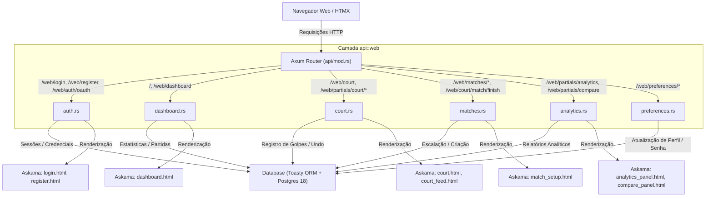

# Arquitetura e Guia de Manutenção: Camada Web (`api::web`)

Este documento serve como guia prático para desenvolvedores entenderem como a camada Web do Player Scout está estruturada após a refatoração e como estendê-la com segurança.

> [!TIP]
> **Novo no projeto?** Recomendamos iniciar a leitura pelo [Guia de Onboarding para Desenvolvedores Juniores](ONBOARDING_JUNIOR.md), que introduz o glossário do Padel, a configuração do ambiente e a visão geral de todas as camadas.

---

## 1. Visão Geral e Motivação da Refatoração

Anteriormente, o arquivo `rust/src/api/web.rs` concentrava mais de **1.430 linhas de código**, misturando fluxos de autenticação, telas de quadra, processamento de formulários, relatórios analíticos e modais. 

Para reduzir a sobrecarga cognitiva e permitir que desenvolvedores trabalhem em partes isoladas sem risco de efeitos colaterais, a camada foi dividida no diretório modular `rust/src/api/web/` com **6 submódulos especializados**:

```
rust/src/api/web/
├── mod.rs          # Ponto de entrada, documentação do módulo e re-exports públicos
├── auth.rs         # Login, Cadastro, Logout, Cookies e Google OAuth2
├── dashboard.rs    # Painel principal do treinador, seleção de atletas e histórico
├── court.rs        # Interface touch-first de quadra (4 atletas, botões de jogada, feed)
├── matches.rs      # Setup de partida, escalação de duplas, sparrings e encerramento
├── analytics.rs    # Fragmentos HTMX dos painéis estatísticos e comparador de sets
└── preferences.rs  # Atualização inline de perfil e troca segura de senha
```

---

## 2. Diagrama de Responsabilidades e Fluxo de Dados



---

## 3. Detalhamento dos Submódulos

### 3.1. `auth.rs` — Autenticação, Cadastro e OAuth2
- **Arquivos relacionados:** `templates/login.html`, `templates/register.html`.
- **Principais funções:**
  - `login_page`: Exibe formulário com tratamento de erros de URL (`unauthorized`, `expired`, etc.).
  - `web_login`: Processamento via formulário tradicional (`POST /web/login`).
  - `web_login_partial`: Processamento via HTMX com substituição dinâmica (`POST /web/partials/auth/login`).
  - `register_page` e `web_register_partial`: Cadastro com validação de CPF, WhatsApp e auto-vínculo de conta OAuth.
  - `web_oauth_authorize` e `web_oauth_callback`: Fluxo OpenID Connect com Cookie Anti-CSRF (`ps_oauth_state`).

### 3.2. `dashboard.rs` — Painel Analítico do Treinador
- **Arquivos relacionados:** `templates/dashboard.html`.
- **Principais funções:**
  - `dashboard_page`: Resolve o atleta ativo do treinador autenticado, lista histórico de partidas e calcula métricas consolidadas de carreira.
  - `calculate_initials`: Helper que extrai as iniciais do treinador/atleta para exibição no avatar do cabeçalho.

### 3.3. `court.rs` — Experiência Touch-First em Quadra
- **Arquivos relacionados:** `templates/court.html`, `templates/partials/court_feed.html`.
- **Principais funções:**
  - `court_page`: Monta a visualização da quadra com os 4 atletas divididos em colunas individuais, com porcentagem `% IN` em tempo real e cores distintas.
  - `court_record_shot_partial`: Ingestão direta de golpe com 1 clique (Winner azul, Erro Não Forçado laranja, Golpe normal).
  - `court_undo_shot_partial`: Desfaz o último golpe registrado na partida.
  - `build_court_feed_html`: Constrói o HTML parcial dos últimos 5 golpes para atualização instantânea via HTMX.

### 3.4. `matches.rs` — Configuração e Gestão de Partidas
- **Arquivos relacionados:** `templates/match_setup.html`.
- **Principais funções:**
  - `match_setup_page`: Tela de escalação com seleção de Dupla A (Revés/Drive) e Dupla B (Revés/Drive).
  - `create_match_web`: Grava a partida e persiste as 4 associações na tabela `match_players`.
  - `rematch_web`: Recria partida instantaneamente mantendo os mesmos 4 atletas e posições.
  - `create_quick_player_web`: Cadastro rápido de atleta convidado/sparring sem sair do fluxo.
  - `finish_match_web`: Encerra a partida e redireciona para o resumo pós-jogo.

### 3.5. `analytics.rs` — Painéis Estatísticos HTMX
- **Arquivos relacionados:** `templates/partials/analytics_panel.html`, `templates/partials/compare_panel.html`.
- **Principais funções:**
  - `analytics_partial`: Fragmento que atualiza os gráficos Chart.js e estatísticas quando o treinador troca de filtro/set.
  - `compare_partial`: Renderiza o comparativo lado a lado (ex: Set 1 vs Set 2).

### 3.6. `preferences.rs` — Preferências de Usuário
- **Principais funções:**
  - `web_update_profile`: Atualiza nome, lado preferido em quadra (`PreferredSide`) e WhatsApp.
  - `web_update_password`: Altera senha com hash Argon2i e renova imediatamente o cookie de sessão (`ps_session`).

---

## 4. Guia Rápido: Como Adicionar uma Nova Rota Web

Se você precisa criar uma nova funcionalidade na interface Web:

1. **Identifique o submódulo correto:** 
   Se for relacionado a partidas, vá para `matches.rs`; se for quadra, `court.rs`, etc.
2. **Defina a Struct do Template Askama (se renderizar HTML novo):**
   ```rust
   #[derive(Template)]
   #[template(path = "meu_template.html")]
   pub struct MeuTemplate {
       pub dado: String,
   }
   ```
3. **Crie a função handler no submódulo:**
   ```rust
   pub async fn minha_rota(
       State(db): State<Database>,
       Extension(auth_user): Extension<AuthenticatedUser>,
   ) -> Result<Html<String>> {
       let html = MeuTemplate { dado: "teste".into() }.render()?;
       Ok(Html(html))
   }
   ```
4. **Registre a rota no roteador central (`rust/src/api/mod.rs`):**
   ```rust
   .route("/web/minha-rota", get(web::minha_rota))
   ```
5. **Escreva o teste em `rust/tests/api_integration_tests.rs`** garantindo que a rota responde com status esperado.
