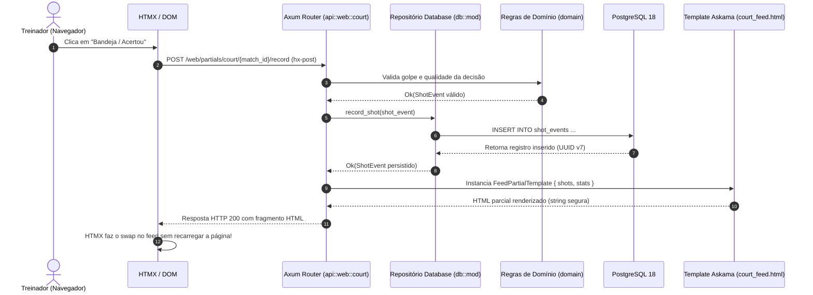

# Guia de Onboarding: Bem-vindo ao Player Scout! 🎾🦀

Olá, desenvolvedor(a)! Seja muito bem-vindo(a) à equipe do **Player Scout**.

Este documento foi criado especialmente para você que está dando seus primeiros passos no projeto. Nosso objetivo é garantir que você compreenda não apenas a nossa pilha tecnológica (Rust, Axum, Toasty ORM, PostgreSQL 18, HTMX e Askama), mas também o **domínio esportivo do Padel**, a **arquitetura do sistema** e as **boas práticas de desenvolvimento** que adotamos.

---

## 📑 Sumário

1. [O que é o Player Scout?](#1-o-que-é-o-player-scout)
2. [Glossário do Padel para Desenvolvedores](#2-glossário-do-padel-para-desenvolvedores)
   - [Os 21 Golpes Mapeados no Sistema](#os-21-golpes-mapeados-no-sistema)
   - [Métricas e Classificação de Jogadas](#métricas-e-classificação-de-jogadas)
   - [A Matriz Tática de Ouro (Decisão × Execução)](#a-matriz-tática-de-ouro-decisão--execução)
3. [Configurando seu Ambiente Local](#3-configurando-seu-ambiente-local)
   - [Pré-requisitos](#pré-requisitos)
   - [Passo a Passo de Inicialização](#passo-a-passo-de-inicialização)
4. [Mapa Mental da Arquitetura](#4-mapa-mental-da-arquitetura)
   - [Camadas do Sistema (DDD Simplificado)](#camadas-do-sistema-ddd-simplificado)
   - [Diagrama: Ciclo de Vida de uma Requisição HTMX](#diagrama-ciclo-de-vida-de-uma-requisição-htmx)
5. [A "Receita de Bolo": Nova Funcionalidade em 5 Passos](#5-a-receita-de-bolo-nova-funcionalidade-em-5-passos)
6. [Guia de Sobrevivência: HTMX + Askama](#6-guia-de-sobrevivência-htmx--askama)
   - [Mentalidade HTMX](#mentalidade-htmx)
   - [Atributos e Cabeçalhos Mais Usados](#atributos-e-cabeçalhos-mais-usados)
   - [Como Debugar no Navegador](#como-debugar-no-navegador)
7. [Comandos Essenciais e Garantia de Qualidade](#7-comandos-essenciais-e-garantia-de-qualidade)
8. [Onde Buscar Ajuda e Próximas Leituras](#8-onde-buscar-ajuda-e-próximas-leituras)

---

## 1. O que é o Player Scout?

O **Player Scout** é uma plataforma analítica para esportes de raquete (com foco prioritário no **Padel**). 

### O Problema que Resolvemos:
Treinadores profissionais precisam registrar as jogadas de uma partida em tempo real (usando celular ou tablet na beira da quadra) sem perder o ritmo do jogo. Além de saber quem venceu o ponto, o treinador quer saber:
- *O atleta errou porque a decisão foi taticamente errada ou apenas falhou na execução mecânica?*
- *Qual o aproveitamento do atleta na Bandeja sob pressão?*
- *Como o desempenho evoluiu do Set 1 para o Set 2?*

Nossa missão é entregar uma interface **touch-first** ultrarrápida para o treinador em quadra e relatórios estatísticos profundos para tomada de decisão tática.

---

## 2. Glossário do Padel para Desenvolvedores

Para programar bem no Player Scout, você não precisa ser um jogador profissional, mas precisa entender os termos que usamos no código e nas regras de negócio em [`rust/src/domain/`](file:///home/jc/codigos/rust/player-scout/rust/src/domain).

### Os 21 Golpes Mapeados no Sistema

No código Rust, eles estão definidos no enum [`ShotType`](file:///home/jc/codigos/rust/player-scout/rust/src/domain/mod.rs):

#### A. Início de Ponto
- **Saque (`Serve`):** No padel, o saque é feito quicando a bola no chão e batendo abaixo da linha da cintura.
- **Recepção / Devolução (`Return`):** A primeira bola devolvida pelo adversário após o saque.

#### B. Fundo de Quadra & Vidros (Defesa e Transição)
- **Batida de Direita (`ForehandGroundstroke`):** Golpe clássico de fundo executado com o lado dominante da mão.
- **Batida de Esquerda (`BackhandGroundstroke`):** Golpe clássico executado com o dorso da mão voltado para o adversário.
- **Globo de Direita (`ForehandLob`) & Globo de Esquerda (`BackhandLob`):** Bola alta jogada no fundo da quadra rival para tirar os adversários da rede e ganhar posição ofensiva.
- **Chiquita (`Chiquita`):** Bola sutil, lenta e rente à rede que cai nos pés do adversário que está na rede, forçando-o a volear de baixo para cima.
- **Saída de Parede Direita (`ForehandWallExit`) & Esquerda (`BackhandWallExit`):** Bater na bola após ela quicar no chão e rebater no vidro traseiro.
- **Bajada de Parede (`WallBajada`):** Quando a bola quica no vidro alto e o atleta bate agressivamente de cima para baixo acelerando a bola.
- **Contra-parede (`BackWallRebound`):** Jogada de emergência em que o atleta bate a bola de costas contra o próprio vidro para ela passar para o outro lado da rede.

#### C. Rede & Ataque
- **Voleio de Direita (`ForehandVolley`) & Voleio de Esquerda (`BackhandVolley`):** Golpe executado no ar, junto à rede, antes da bola quicar no chão.
- **Bandeja (`Bandeja`):** Golpe aéreo defensivo/posicional típico do padel, sem salto, com a raquete ligeiramente aberta para não perder a rede após um globo rival.
- **Víbora (`Vibora`):** Golpe aéreo agressivo, com efeito lateral cortado (slice), feito ao lado da cabeça para que a bola morra no vidro após o quique.
- **Smash Trazer (`SmashBringBack`):** Smash de potência em que a bola quica no chão adversário, bate no vidro de fundo e volta para o próprio campo do atacante.
- **Smash por 3 (`SmashKick3` ou "x3"):** Smash em que a bola quica no vidro e é ejetada lateralmente para fora da quadra por cima da grade de 3 metros de altura.
- **Smash por 4 (`SmashKick4` ou "x4"):** Smash tão forte que a bola bate no vidro de fundo e é ejetada para fora por cima da parede traseira de 4 metros de altura.
- **Rulo na Grade (`FenceRulo`):** Golpe aéreo com efeito topspin jogado intencionalmente na grade metálica lateral para criar um quique imprevisível.
- **Deixadinha (`DropShot`):** Toque suave amortecido para fazer a bola quicar duas vezes colada à rede.
- **Bloqueio (`Block`):** Firmeza de raquete na rede para amortecer um golpe forte do adversário.

---

### Métricas e Classificação de Jogadas

Para cada jogada registrada, o treinador seleciona:

1. **Resultado (`ShotOutcome`):**
   - `In` (Acertou): A bola foi para o campo adversário e continuou em jogo ou foi ponto.
   - `Out` (Errou): A bola foi na rede, fora da quadra ou na grade sem antes ter tocado o chão.
2. **Qualidade de Decisão (`DecisionQuality`):**
   - `Good` (Boa Decisão): A escolha tática fazia sentido dado o posicionamento do rival e o estado do ponto.
   - `Bad` (Decisão Ruim): A escolha do golpe foi inadequada (ex: tentar um smash de muito longe sem ângulo).
3. **Tags Especiais (`SpecialTag`):**
   - `None`: Jogada regular de troca de bolas (rally).
   - `Winner`: Ponto vencedor direto sem que o adversário consiga tocar na bola.
   - `UnforcedError` (ENF / Erro Não Forçado): Erro cometido em uma bola fácil, sem pressão adversária.
   - `ForcedError` (Erro Forçado): Erro decorrente de um golpe excelente do adversário.

---

### A Matriz Tática de Ouro (Decisão × Execução)

O grande diferencial do Player Scout é cruzar **Resultado × Decisão**:

| Decisão \ Resultado | Acertou (`In`) | Errou (`Out`) |
| :--- | :--- | :--- |
| **Boa Decisão (`Good`)** | 🟢 **Excelente:** Escolha tática correta e execução técnica perfeita. | 🟡 **Erro Técnico:** A escolha foi correta, faltou apenas refino mecânico (o treinador corrige a técnica, não a tática). |
| **Decisão Ruim (`Bad`)** | 🟠 **Sorte / Compensação:** O atleta tomou uma decisão arriscada ou errada, mas contou com sorte ou erro do rival. | 🔴 **Erro Tático Grave:** O atleta escolheu o golpe errado e ainda errou a execução. |

---

## 3. Configurando seu Ambiente Local

### Pré-requisitos
Certifique-se de ter instalado em sua máquina:
- **Rust Toolchain:** Rust `1.99.x` ou superior (Edition 2024). Verifique com `rustc --version`.
- **Docker e Docker Compose:** Para subir o PostgreSQL 18. Verifique com `docker compose version`.
- **Git:** Para versionamento.

### Passo a Passo de Inicialização

#### 1. Clonar o repositório e entrar na pasta
```bash
git clone https://github.com/seu-usuario/player-scout.git
cd player-scout
```

#### 2. Configurar o `.env`
Copie o arquivo `.env.example` para `.env`:
```bash
cp .env.example .env
```
> [!IMPORTANT]
> **Aviso de Segurança:** Nunca faça commit do arquivo `.env` nem coloque credenciais de produção nele. O arquivo `.gitignore` já ignora o `.env`.

#### 3. Subir o PostgreSQL 18 via Docker
```bash
docker compose up -d
```
Verifique se o container está saudável:
```bash
docker compose ps
```
> [!NOTE]
> O arquivo `docker-compose.yml` mapeia a pasta `./migrations` diretamente para `/docker-entrypoint-initdb.d`. Isso significa que, na primeira vez que o banco sobe, todas as migrações SQL (`001` até `007`) são executadas automaticamente!

#### 4. Executar os Testes Automatizados
Rode os testes para garantir que tudo está 100% funcional:
```bash
# Testes rápidos de domínio puro (sem banco):
cargo test --manifest-path rust/Cargo.toml --test domain_validation_tests

# Testes de integração com a API e PostgreSQL:
cargo test --manifest-path rust/Cargo.toml --test api_integration_tests
```

#### 5. Iniciar a Aplicação
```bash
cargo run --manifest-path rust/Cargo.toml
```
Acesse no seu navegador: **`http://localhost:3000`**.

---

## 4. Mapa Mental da Arquitetura

O Player Scout adota uma arquitetura em camadas inspirada em Domain-Driven Design (DDD) e Clean Architecture, mantendo os módulos simples e legíveis.

```
player-scout/
├── migrations/               # Scripts SQL versionados do PostgreSQL 18
├── docs/                     # Documentação técnica e arquitetural
└── rust/
    ├── Cargo.toml            # Dependências e toolchain Rust
    ├── templates/            # Templates HTML Askama (compilados)
    │   ├── base.html         # Shell principal com Tailwind e HTMX
    │   ├── login.html        # Telas de autenticação
    │   ├── court.html        # Interface de scout na quadra
    │   └── partials/         # Fragmentos HTMX reativos
    └── src/
        ├── domain/           # 🧠 REGRAS PURAS (Zero I/O, Zero SQL)
        ├── db/               # 💾 Toasty ORM + PostgreSQL (models.rs e Database)
        ├── api/              # 🌐 Camada de Apresentação HTTP Axum
        │   ├── v1/           # Endpoints REST JSON (/api/v1)
        │   └── web/          # Handlers HTMX e Askama (/web e /)
        │       ├── auth.rs
        │       ├── dashboard.rs
        │       ├── court.rs
        │       ├── matches.rs
        │       ├── analytics.rs
        │       └── preferences.rs
        ├── config/           # Variáveis de ambiente type-safe (AppConfig)
        ├── error/            # AppError unificado com conversões HTTP
        └── lib.rs            # Ponto de entrada da crate e factory da aplicação
```

### Camadas do Sistema

1. **Domínio (`rust/src/domain/`):**
   - É o "coração" do sistema. Contém structs (`Player`, `MatchSession`, `ShotEvent`), regras de negócio e validações puras (ex: validação de CPF, normalização de e-mails, cálculo da matriz de ouro).
   - **Regra de Ouro:** O domínio **nunca** faz queries SQL, não acessa rede nem depende do Axum.

2. **Acesso a Dados (`rust/src/db/`):**
   - Conecta ao PostgreSQL 18 usando o **Toasty ORM**.
   - `models.rs`: Mapeamento relacional das tabelas com macros `#[derive(toasty::Model)]`.
   - `mod.rs`: Wrapper `Database` que encapsula o pool e implementa os métodos de repositório.

3. **Apresentação Web (`rust/src/api/web/`):**
   - Handlers Axum que recebem requisições do navegador, chamam o `Database` e renderizam templates Askama.
   - Está dividido em submódulos coesos (leia [docs/MODULARIZACAO_WEB.md](file:///home/jc/codigos/rust/player-scout/docs/MODULARIZACAO_WEB.md) para detalhes).

---

### Diagrama: Ciclo de Vida de uma Requisição HTMX

Abaixo, veja como uma ação do usuário (ex: registrar um golpe na quadra) transita pelas camadas:



---

## 5. A "Receita de Bolo": Nova Funcionalidade em 5 Passos

Siga este roteiro sempre que for adicionar uma nova funcionalidade no Player Scout:

### Passo 1: Regras no Domínio (`rust/src/domain/`)
Crie ou altere as structs, enums e funções puras em `domain/`. Adicione testes unitários imediatos no próprio módulo ou em `tests/domain_validation_tests.rs`.
*Exemplo:* Adicionar uma nova métrica ou regra de validação.

### Passo 2: Persistência no Banco (`migrations/` e `rust/src/db/`)
Se a funcionalidade exigir novas colunas ou tabelas:
1. Crie uma nova migração SQL numerada em `migrations/` (ex: `008_nome_da_migracao.sql`).
2. Atualize `rust/src/db/models.rs` adicionando o modelo Toasty correspondente.
3. Adicione os métodos de consulta no repositório `Database` em `rust/src/db/mod.rs`.
*(Consulte [docs/MIGRATIONS_E_TOASTY_ORM.md](file:///home/jc/codigos/rust/player-scout/docs/MIGRATIONS_E_TOASTY_ORM.md) para o guia detalhado).*

### Passo 3: Handler HTTP (`rust/src/api/web/` ou `rust/src/api/v1/`)
- Se for uma tela ou componente visual interativo, crie o handler no submódulo apropriado de `rust/src/api/web/` (ex: `court.rs`, `dashboard.rs`).
- Se for uma API para consumo externo ou aplicativo móvel, adicione em `rust/src/api/v1/`.

### Passo 4: Template HTML e HTMX (`rust/templates/`)
- Defina uma struct com `#[derive(Template)]` do Askama no seu arquivo Rust.
- Crie o template HTML correspondente em `rust/templates/`.
- Adicione os atributos HTMX necessários (`hx-post`, `hx-target`, `hx-swap`).

### Passo 5: Testes Automatizados e Verificações
Escreva um teste de integração em `rust/tests/api_integration_tests.rs` simulando a requisição HTTP e verificando o status code e o HTML retornado.

---

## 6. Guia de Sobrevivência: HTMX + Askama

### Mentalidade HTMX
Ao contrário de SPAs tradicionais (React/Vue/Angular), com HTMX o servidor não devolve JSON para ser processado por centenas de megabytes de JavaScript no cliente. O servidor devolve **HTML pronto**, e o HTMX apenas substitui o pedaço correspondente no DOM!

### Atributos e Cabeçalhos Mais Usados

| Atributo / Cabeçalho | Para que serve? | Exemplo de Uso |
| :--- | :--- | :--- |
| `hx-get="url"` | Faz uma requisição GET assíncrona ao clicar | `<button hx-get="/web/partials/stats">Atualizar</button>` |
| `hx-post="url"` | Envia dados via POST | `<form hx-post="/web/court/record">` |
| `hx-target="#id"` | Define qual elemento da página receberá o HTML retornado | `hx-target="#court-feed-container"` |
| `hx-swap="metodo"` | Define como o conteúdo será injetado (`innerHTML`, `outerHTML`, `afterbegin`, `beforeend`) | `hx-swap="afterbegin"` (adiciona no topo da lista) |
| `hx-indicator="#id"` | Exibe um spinner de loading enquanto a requisição ocorre | `hx-indicator="#loading-spinner"` |
| `HX-Redirect` *(header)* | Cabeçalho HTTP retornado pelo Rust para redirecionar o navegador | `[("HX-Redirect", "/web/dashboard")]` |
| `HX-Trigger` *(header)* | Dispara eventos customizados no JavaScript ou no próprio HTMX | `[("HX-Trigger", "refreshStats")]` |

### Vantagens do Askama
- **Type-Safe em Tempo de Compilação:** Se você errar o nome de uma variável no template HTML, **o compilador Rust não compila**! Você nunca terá erros em produção de campos inexistentes no template.
- **Performance Extrema:** Os templates são transformados em código Rust nativo durante o `cargo build`.

### Como Debugar no Navegador
1. Abra as Ferramentas do Desenvolvedor (**F12**) no Chrome/Firefox.
2. Vá para a aba **Network** (Rede) e filtre por **Fetch/XHR**.
3. Ao clicar em um botão HTMX, inspecione a requisição enviada e a **Response** recebida.
4. Você verá o fragmento HTML exato que o Rust gerou. Se a tela não atualizar, verifique na aba **Console** se o seletor definido no `hx-target` existe na página atual.

---

## 7. Comandos Essenciais e Garantia de Qualidade

Nosso projeto preza pela **máxima qualidade e estabilidade**. Antes de enviar qualquer alteração para Pull Request, execute a rotina de validação:

### 1. Formatação de Código
```bash
# Verificar se o código está formatado segundo o padrão Rust:
cargo fmt --check --manifest-path rust/Cargo.toml

# Aplicar a formatação automaticamente:
cargo fmt --manifest-path rust/Cargo.toml
```

### 2. Análise Estática com Clippy (Zero Warnings)
No Player Scout, nenhum warning é permitido no CI:
```bash
cargo clippy --manifest-path rust/Cargo.toml --all-targets -- -D warnings
```

### 3. Suíte Completa de Testes Automatizados
```bash
# Executar todos os testes:
cargo test --manifest-path rust/Cargo.toml
```
> [!IMPORTANT]
> **Regra Fundamental:** 100% dos testes devem passar sempre. Se um teste falhar, descubra a causa raiz e corrija o código. Nunca comente nem enfraqueça um teste para fazê-lo passar.

### 4. Auditoria de Segurança
```bash
cargo audit
```

---

## 8. Onde Buscar Ajuda e Próximas Leituras

Agora que você tem uma visão completa do projeto, recomendamos ler a documentação complementar conforme for atuar em cada área:

- 📖 [`AGENTS.md`](file:///home/jc/codigos/rust/player-scout/AGENTS.md): Regras fundamentais, diretrizes do produto, política de testes e convenções do time.
- 🌐 [`docs/MODULARIZACAO_WEB.md`](file:///home/jc/codigos/rust/player-scout/docs/MODULARIZACAO_WEB.md): Detalhamento dos submódulos da camada Web (`auth`, `dashboard`, `court`, `matches`, `analytics`, `preferences`).
- 💾 [`docs/MIGRATIONS_E_TOASTY_ORM.md`](file:///home/jc/codigos/rust/player-scout/docs/MIGRATIONS_E_TOASTY_ORM.md): Manual técnico do banco de dados relacional, Toasty ORM e como criar migrações SQL com segurança.
- 🗺️ [`ROADMAP.md`](file:///home/jc/codigos/rust/player-scout/ROADMAP.md): Acompanhe as fases concluídas e as próximas metas do projeto.

Conte com a equipe para tirar dúvidas. Bom desenvolvimento e ótimo scouting! 🚀🎾
